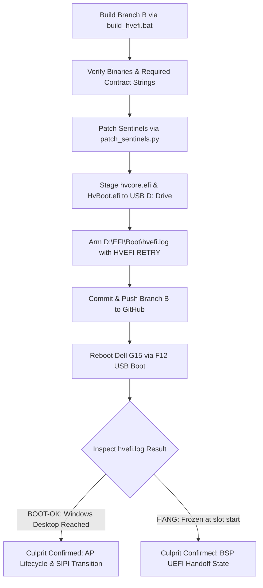

# HvEfi Hardware Bisection: Current Condition and Next Steps

**Document Reference**: `HVEFI-STATUS-NEXT-STEPS-2026-10-20`  
**Target Hardware**: Dell G15 5530 (Intel Core i5-13450HX, 6P + 4E cores / 16 threads, InsydeH2O BIOS 1.35.0, Dual-NVMe)  
**Repository**: `Kalpajit0406/HvEfi`  
**Current Branch**: `main`  
**Current Date**: October 20, 2026  

---

## 1. Executive Summary & Why the Latest Reboot Froze

During the previous interaction, the physical machine was rebooted by the user while Branch B was being staged in source. Examination of the hardware logs on the target USB drive (`D:\EFI\Boot\hvefi.log`) demonstrates:
- The binary executed on the Dell was **Branch A** (`proc2=1052680`, bit 1 `PROC2_ENABLE_EPT` cleared, `vcpus=16`, `EXITS total=2766`).
- Source edits for Branch B (`hv_vmcs.c` and `hv_efi_smp.c`) were in the local working tree but had not yet been compiled, patched, and staged to `D:\EFI\Boot\hvcore.efi`.
- Consequently, the latest boot attempt re-ran the Branch A test, confirming that the Branch A freeze at `HVEFI CHAIN WIN slot start` is completely repeatable.

---

## 2. Empirical Test Results Matrix (Hardware Receipts)

Every test follows the bisection protocol: one change, one commit, one Dell bare-metal boot, one receipt in `receipts/`.

| Stage / Test Step | Hardware Configuration Tested | Git Commit | Receipt File | Bare-Metal Result | Telemetry & VM Exit Profile |
| :--- | :--- | :--- | :--- | :--- | :--- |
| **Baseline (Pre-Bisect)** | Masked `CR4.VMXE`, 1:1 Identity EPT, CPUID Leaf 1 masked, 16 CPUs virtualized | `bbbe115` | `receipts/dell_baremetal_b2_full_bringup_receipt.log` | **`HANG`** | Stalls at `slot start`; infinite CPUID loop at Dell splash screen. |
| **Step 0 (Minimal Config)** | Core virtualization only: EPT ON (1:1), CPUID pure passthrough, empty MSR bitmap, TSC offset OFF, VPID OFF, CR masks 0 | `db85b55` | [`receipts/bisect_step0_hang.log`](receipts/bisect_step0_hang.log) | **`HANG`** | Stalls at `slot start`; 2,392 VM exits; `proc2=1052810` (EPT bit 1 ON). |
| **Branch A (EPT OFF)** | Step 0 + `PROC2_ENABLE_EPT = 0` (guest-phys = host-phys), `PROC2_UNRESTRICTED_GUEST = 0`, `VMCS_EPT_PTR = 0` | `c94d251` | [`receipts/bisect_branchA_hang.log`](receipts/bisect_branchA_hang.log) | **`HANG`** | Stalls at `slot start`; 2,766 VM exits; `proc2=1052680` (EPT bit 1 OFF). |
| **Branch B (BSP-Only)** | Step 0 + EPT ON + BSP-only virtualization (APs 1–15 left native in DXE) | *(In Progress)* | `receipts/bisect_branchB_<result>.log` | *Pending compilation, flash & boot* | Expected `vcpus=1`; isolates AP lifecycle from BSP handoff. |

---

## 3. Core Architectural Deductions

### 3.1. EPT is Conclusively Exonerated
- In **Branch A**, Extended Page Tables were completely disabled in hardware VMCS secondary execution controls:
  - `PROC2_ENABLE_EPT` was cleared.
  - `VMCS_EPT_PTR` was explicitly written to `0`.
  - Memory addressing operated in pure 1-level translation where Guest Physical Address equals Host Physical Address directly (`GPA == HPA`).
- **Result**: The machine still froze at the identical location (`HVEFI CHAIN WIN slot start`) after 2,766 clean VM exits.
- **Deduction**: EPT table generation, 2MB large page splitting, RAM range descriptor coalescing, and EPT memory attributes (WB/UC) have zero impact on the hang. EPT is 100% ruled out.

### 3.2. Primary Suspect: AP Virtualization & OS SIPI Trampoline Handshake
Because EPT is ruled out and the hang occurs when Windows Boot Manager transitions to kernel startup:
1. **Firmware DXE Parking**:
   - On the Dell InsydeH2O BIOS, APs 1–15 sit parked in a firmware loop (`mWaitLoop` / `Pause`) in DXE.
   - HvEfi virtualizes all 15 APs via `StartupThisAP`. They enter VMX root mode, run `VMLAUNCH`, and return to firmware code **inside VMX non-root mode**.
2. **The OS Trampoline Handshake**:
   - When `bootmgfw.efi` launches the Windows kernel, it sends INIT-SIPI-SIPI to wake APs into a real-mode startup trampoline (`0x000N_0000`).
   - In `hv_exit.c:1069`, the SIPI handler resets the AP to 16-bit real mode and clears `ENTRY_CTRL_IA32E_MODE_GUEST`.
   - As the AP executes the OS trampoline, it switches CPU modes: real mode $\to$ protected mode $\to$ 64-bit long mode.
   - Because `VMCS_CR0_GUEST_HOST_MASK` is 0, `MOV CR0` does not cause a VM exit.
   - When the AP takes its first VM-exit in long mode (CPUID, interrupt, or MSR read), `VMCS_GUEST_EFER.LMA` is 1, but `VMCS_ENTRY_CONTROLS.ENTRY_CTRL_IA32E_MODE_GUEST` may still be 0.
   - Per Intel SDM Vol 3C §26.3.1.5, this triggers `VM-entry failure: invalid guest state` (`VMENTRY_FAIL_GUEST_STATE`), crashing the AP.
   - The BSP sits in a spinlock / barrier awaiting AP check-in, causing the hang at the Dell logo.

---

## 4. Current Codebase Condition (Branch B Implementation)

The codebase has been prepared for **Branch B (BSP-Only Virtualization)** with the following exact changes:

### 4.1. `hv_vmcs.c` (Lines 250–255, 321–323)
- Restored `PROC2_ENABLE_EPT` and `PROC2_UNRESTRICTED_GUEST` to Step 0 baseline.
- Restored `HvVmWriteChecked(VMCS_EPT_PTR, g_Hv.Ept.EptPointer)`.

### 4.2. `hv_efi_smp.c` (Lines 662–666)
- Bypassed the AP bringup loop (`StartupThisAP` calls skipped for APs 1–15).
- Assigned `g_Hv.VcpuCount = 1` and `g_Hv.TargetVcpuCount = 1`.
- APs 1–15 remain completely native and un-virtualized in Dell DXE firmware.
- Only the BSP (CPU 0) enters VMX root mode and runs virtualized.

---

## 5. Detailed Next Steps



### Step 5.1: Build Completion & Validation
- Compile `HvEfi.efi` and `HvBoot.efi` using `build_hvefi.bat`.
- Ensure post-build contract checks succeed:
  - `"EPT hiding complete"`
  - `"Step 1: VMX supported"`
  - `"All %u CPUs virtualized"`
  - Sentinel checks verified.

### Step 5.2: Stage to Physical USB (`D:\`)
- Run:
  ```powershell
  python patch_sentinels.py HvEfi.efi D:\EFI\Boot\hvcore.efi
  python patch_sentinels.py HvBoot.efi D:\EFI\Boot\HvBoot.efi
  Copy-Item D:\EFI\Boot\HvBoot.efi D:\EFI\Boot\BOOTX64.EFI -Force
  ```
- Verify:
  - `D:\EFI\Boot\hvcfg` contains `'F'`.
  - `D:\EFI\Boot\hvefi.log` contains fresh `HVEFI RETRY`.

### Step 5.3: Git Commit and Push
- Commit: `bisect(branchB): Step 0 with BSP-only virtualization (APs left native)`
- Push to GitHub `origin/main` and verify `HEAD == origin/main`.

### Step 5.4: Physical Dell G15 Boot
- User powers on Dell G15, presses F12, and selects the UEFI USB Drive.
- HvBoot initializes and chains into `hvcore.efi`.
- Expected receipt signature: `HVEFI VMCALL STATUS vcpus=1`.

### Step 5.5: Evaluation & Subsequent Action
1. **If Branch B reaches Windows 11 Desktop (`BOOT-OK`)**:
   - Proves beyond all doubt that the hypervisor core, EPT, VMCS baseline, memory layout, and BSP handoff are 100% correct.
   - The bug is strictly isolated to AP bringup, AP DXE parking loop return, or the AP SIPI real-mode to 64-bit transition.
   - Next action: Fix the AP mode sync in `hv_exit.c` and re-enable AP virtualization.
2. **If Branch B still freezes at `slot start` (`HANG`)**:
   - Proves the hang occurs on the BSP alone, independent of multi-processor synchronization.
   - Next action: Bisect BSP handoff state (external interrupt delivery, LAPIC timer, GDT/TSS selector consistency, or UEFI memory map descriptors passed to `ExitBootServices`).
